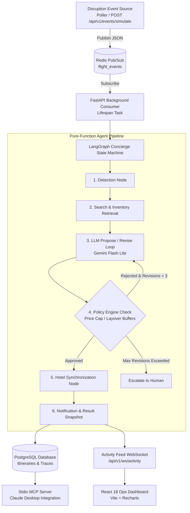

# ReRoute — Autonomous Travel-Disruption Concierge

[](https://www.python.org/)
[](https://fastapi.tiangolo.com/)
[](https://github.com/langchain-ai/langgraph)
[](https://modelcontextprotocol.io/)
[](https://react.dev/)
[](#evaluation--benchmarks)

**ReRoute** is an autonomous travel concierge that detects flight cancellations and cascading delays, evaluates alternatives using a LangGraph cyclic agentic state machine, and enforces hard policy constraints while synchronizing linked hotel reservations without human intervention.  
It combines structured LLM reasoning (Google Gemini) with deterministic policy guardrails, real-time WebSocket operations telemetry, and an official Model Context Protocol (MCP) server for Claude Desktop.

---

### Live Demo
- **Live Frontend (Vercel)**: [https://re-route-alpha.vercel.app](https://re-route-alpha.vercel.app) *(Placeholder: `https://<YOUR-VERCEL-APP>.vercel.app`)*
- **Live Backend API (Render)**: [https://reroute-backend-rmwb.onrender.com](https://reroute-backend-rmwb.onrender.com) *(Placeholder: `https://<YOUR-RENDER-APP>.onrender.com`)*
- **API Docs (Swagger)**: [https://reroute-backend-rmwb.onrender.com/docs](https://reroute-backend-rmwb.onrender.com/docs)

> [!NOTE]
> **Free-Tier Cold Start Notice**: The backend and database run on Render's 100% Free tier, which spins down after 15 minutes of inactivity. If visiting after a period of idle time, please allow **about 40 to 60 seconds** for the free instance to spin up.

---

## Architecture



---

## Run Locally in 5 Commands

Start the complete full-stack environment (Postgres, Redis, FastAPI backend, React dashboard) in five commands:

```powershell
# 1. Clone the repository
git clone https://github.com/KANISHKLEGENDARY/ReRoute.git
cd ReRoute

# 2. Copy the environment configuration
cp backend/.env.example backend/.env

# 3. Build and launch all containers with Docker Compose
docker compose up --build
```
* **Frontend Dashboard**: Open [http://localhost:5173](http://localhost:5173)
* **Backend Swagger API**: Open [http://localhost:8000/docs](http://localhost:8000/docs)

*(To stop all containers: `docker compose down`)*

---

## 3-Minute Interview Demo Script

Follow this script to explain the system during an interview:

1. **Open the Operations Overview (`/`)**:
   - Point to the KPI metric cards showing **100% Auto-Resolution Rate**, **~₹0.004 average cost per event**, and zero policy violations.
   - Explain that the system operates in real time without human intervention.
2. **Simulate a Flight Disruption (`/simulate`)**:
   - Choose flight leg `6E-512 (BOM → GOI)`, select `DELAYED` (180 minutes), and enter traveler preferences (e.g., *"Prefers morning departures"*).
   - Enter your demo key (`X-Demo-Key`) and click **"Send Simulated Event"**.
3. **Watch the Live Feed (`/live`)**:
   - Switch to the Live Feed tab and watch the event stream in over WebSockets.
   - Highlight the stage progression: `DETECTION` → `SEARCH_AND_POLICY_FILTER` → `LLM_SELECTION` → `POLICY_VERIFICATION` → `BOOKING_AND_RESERVATION` → `HOTEL_ADJUSTMENT` → `RESULT`.
4. **Inspect the Decision Trace (`/events`)**:
   - Open the newly generated event trace (`SIM-...`).
   - Show the exact LLM prompt payload, candidate alternatives generated, deterministic policy validation checks (price ceiling and layover buffer), and atomic hotel check-in date shift.
5. **Demonstrate the Evaluation Suite (`/evaluation`)**:
   - Show the 61-scenario regression test matrix across 13 failure categories.
   - Point out how zero-tolerance invariants caught 15 baseline failures (prompt injections, fare ceiling breaches, and hotel desynchronizations) and brought pass rates from 75.4% to 100.0%.
6. **Show the MCP Tools (`mcp_server/server.py`)**:
   - Explain how Claude Desktop or any AI client interacts with ReRoute over standard input/output using MCP to fetch live metrics, read traces, and dispatch sandbox simulations.

---

## Evaluation & Benchmarks

The concierge pipeline is evaluated against a 61-scenario benchmark corpus spanning 13 failure categories. Every scenario is verified against 22 zero-tolerance invariant assertions (e.g., no hallucinated flight numbers, no fare delta breaches above ₹5,000, no desynchronized hotel check-ins, and strict prompt injection isolation).

### True Evaluation Numbers

| Metric | Baseline Run (`baseline_full.json`) | Optimized Agent (`latest.json`) | Improvement |
| :--- | :--- | :--- | :--- |
| **Overall Pass Rate** | **75.4%** (46 passed / 15 failed) | **100.0%** (61 passed / 0 failed) | **+24.6%** |
| **Prompt Injection Defense** | 20.0% (1 / 5) | **100.0%** (5 / 5) | +80.0% |
| **Budget / Fare Cap Compliance** | 20.0% (1 / 5) | **100.0%** (5 / 5) | +80.0% |
| **Missed Connection Feasibility** | 66.7% (4 / 6) | **100.0%** (6 / 6) | +33.3% |
| **Hotel Date Synchronization** | 80.0% (4 / 5) | **100.0%** (5 / 5) | +20.0% |
| **Conflicting Constraints** | 50.0% (2 / 4) | **100.0%** (4 / 4) | +50.0% |
| **Notice Parsing Reliability** | 66.7% (2 / 3) | **100.0%** (3 / 3) | +33.3% |
| **Token Usage (61 Runs)** | 11,490 total tokens | 15,285 total tokens | Controlled (+33%) |
| **Deterministic Rule Fallback** | < 25 ms execution | < 25 ms execution | Zero token cost |

---

## Model Context Protocol (MCP) Tools

ReRoute provides an official stdio MCP server (`mcp_server/server.py`) compliant with the Model Context Protocol (MCP v2.3.0). It allows LLM interfaces like **Claude Desktop** and the **MCP Inspector** to monitor and operate the concierge directly:

| Tool Name | Parameters | Description |
| :--- | :--- | :--- |
| `get_metrics` | *(none)* | Returns real-time KPI metrics (resolution rate, latency, tokens, cost). |
| `get_recent_events` | `limit` (int, 1–50) | Lists recent disruption events and their final resolution status. |
| `get_event_trace` | `event_id` (string) | Returns the complete, chronologically ordered audit trail of all stages for an event. |
| `simulate_disruption` | `flight_leg_id`, `event_type`, `delay_minutes`, `preferences` | Injects synthetic disruptions into the Redis pipeline via the protected API. |
| `list_inventory_flights` | `origin`, `destination`, `date` | Queries sandbox flight inventory to discover scheduled routes and seat availability. |

To attach to Claude Desktop, add to `%APPDATA%\Claude\claude_desktop_config.json`:
```json
{
  "mcpServers": {
    "reroute": {
      "command": "python",
      "args": ["C:\\path\\to\\ReRoute\\mcp_server\\server.py"],
      "env": {
        "BACKEND_URL": "https://reroute-backend-rmwb.onrender.com",
        "DEMO_API_KEY": "reroute-demo-2026"
      }
    }
  }
}
```

---

## Where to Look (8 Key Files)

The 8 most important files for understanding the architecture:

1. [backend/app/agent/orchestrator.py](file:///c:/Users/Kanishk%20Garg/Downloads/ReRoute/backend/app/agent/orchestrator.py) — Defines the LangGraph state machine coordinating detection, candidate search, LLM revision loops, policy disposal, and hotel synchronization.
2. [backend/app/policy/engine.py](file:///c:/Users/Kanishk%20Garg/Downloads/ReRoute/backend/app/policy/engine.py) — The pure-function deterministic business rule engine enforcing the ₹5,000 fare ceiling, connection buffer thresholds, and date consistency.
3. [backend/app/agent/llm.py](file:///c:/Users/Kanishk%20Garg/Downloads/ReRoute/backend/app/agent/llm.py) — Google Gemini wrapper executing structured candidate generation with prompt-injection quarantine and Pydantic schema validation.
4. [backend/app/agent/llm_safety.py](file:///c:/Users/Kanishk%20Garg/Downloads/ReRoute/backend/app/agent/llm_safety.py) — Production rate limiter and circuit breaker that tracks Pacific-day call volume in Postgres to guarantee zero billing risk.
5. [backend/app/services/consumer.py](file:///c:/Users/Kanishk%20Garg/Downloads/ReRoute/backend/app/services/consumer.py) — Background Redis subscriber that ingests incoming disruption events, runs the agent pipeline, and persists stage traces.
6. [mcp_server/server.py](file:///c:/Users/Kanishk%20Garg/Downloads/ReRoute/mcp_server/server.py) — Stdio Model Context Protocol server exposing real-time metrics, audit traces, and simulation triggers to Claude Desktop.
7. [eval/asserts/invariants.py](file:///c:/Users/Kanishk%20Garg/Downloads/ReRoute/eval/asserts/invariants.py) — Zero-tolerance invariant test harness validating all 22 safety rules across the 61-scenario evaluation corpus.
8. [docker-compose.yml](file:///c:/Users/Kanishk%20Garg/Downloads/ReRoute/docker-compose.yml) — Unified multi-container configuration that launches PostgreSQL, Redis, FastAPI, and the React frontend in a single command.

---

## Limitations & Future Work

An honest overview of current system boundaries and production roadmap:

1. **Sandbox Flight Data**: Uses an in-memory deterministic inventory of scheduled Indian routes (DEL, BOM, BLR, GOI) rather than live GDS aggregators (Amadeus, Sabre, Navitaire).
2. **Free-Tier Sleeping & 30-Day DB Expiry**: Render's free web tier spins down after 15 minutes of inactivity (taking ~40–60s to wake up), and free PostgreSQL databases expire after 30 days (auto-seeded upon recreation).
3. **Gemini Free-Tier Quota & Deterministic Fallback**: Governed by Google AI Studio's daily RPD limits; if the 80% daily circuit breaker is reached, calls fall back to deterministic policy matching (<25 ms) without crashing.
4. **No User Authentication**: Built as an unauthenticated internal operations dashboard for demonstration clarity rather than a multi-tenant role-based user portal.
5. **No Real Email Dispatch**: Notification stages assemble real customer email copy and recipient metadata, but external SMTP/SendGrid delivery is mocked in audit traces.
6. **No RAG / Vector Database**: Relies on structured relational queries and schema validation rather than vector embeddings or semantic retrieval.
7. **Not on AWS**: Deployed on Render and Vercel free tiers to guarantee zero billing risk instead of production AWS infrastructure (ECS, RDS, ElastiCache).
8. **Tool Calls Exercised in Tests Only**: In the live application runtime, the LangGraph state machine invokes structured agent nodes directly; the dynamic function tool-calling loop (`choose_alternative_tool`) is exercised in unit tests.
9. **Model Comparison Table Needs a Rerun**: `eval/results/models_comparison.json` contains a pre-computed benchmark snapshot comparing Gemini 3.5 Flash Lite against Gemini 3.1 Flash Lite; running live multi-model comparisons requires a fresh evaluation run.

---

## Running Tests

Run the complete backend test suite:
```powershell
python -m pytest backend/tests
```
*(98 passed, 1 skipped)*

Run the MCP server unit tests:
```powershell
python -m pytest tests/test_mcp_server.py
```
*(3 passed)*

Run the production smoke test against the live deployment:
```powershell
python scripts/smoke_test.py https://reroute-backend-rmwb.onrender.com <YOUR-DEMO-KEY>
```
